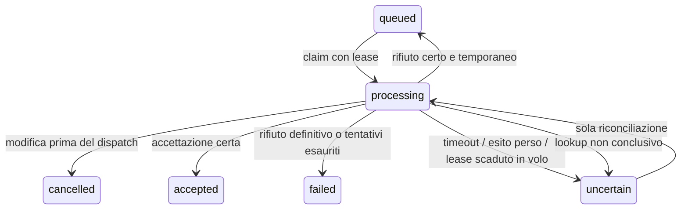

# Glow — worker dei reminder (W15)

Il motore outbox è eseguibile e verificato con un provider di prova locale.
**Gli invii reali sono disattivati**: la configurazione globale nasce disabled,
ogni studio conserva il proprio `reminders_enabled=false` iniziale, il comando
ufficiale rifiuta di acquisire lavori se manca l’adattatore reale. Resend, DNS,
mittente/Reply-To e consegna in inbox restano W16, come richiesto dall’utente.
Nessuna credenziale o configurazione del dominio è necessaria per questi test.

## Stato persistente e confine di invio

`public.messages` conserva stato, tentativi, prossima esecuzione, ID provider,
codice tecnico e richiesta di annullamento. Quattro tabelle private, tutte RLS
senza accesso ordinario, conservano configurazione, run/heartbeat, lease/snapshot
e allarmi: `reminder_settings`, `reminder_runs`, `reminder_dispatches`,
`reminder_alerts`. Nessun destinatario o testo viene esposto nei report di salute.



Acquisizione di un lavoro alla volta, lease 60s e token di fencing diverso per
ogni claim. Il lock segue tenant → appuntamento → messaggio; le modifiche di
appuntamenti e recapiti condividono l’ordine. `SKIP LOCKED` evita che due worker
acquisiscano lo stesso lavoro, senza mantenere una transazione durante la rete.

Subito prima del provider, una RPC ricontrolla interruttori, revisione e stato
della seduta, annullamento, cliente/recapito e finestra di invio. Una modifica
commessa **prima di questo confine** impedisce l’invio. Superato il confine, una
richiesta esterna potrebbe essere partita: un annullamento registra il fatto,
non dichiara richiamata un’email. L’accettazione tardiva resta nello storico.
Non si promette una transazione distribuita o una consegna esattamente una volta.

Il testo viene fissato al primo dispatch: solo studio, data/ora nella timezone
dello studio e invito a contattarlo. Non include nome della cliente, servizio,
anamnesi, foto o dettagli clinici. Destinatario, oggetto e testo sono privati e
immutati nei retry. Se cambia il recapito, il vecchio payload non viene inviato.
W16 deve includere anche identità del mittente/Reply-To verificati nello snapshot
versionato prima di attivare il provider reale.

## Retry, errori e arresti

Chiave stabile `glow-reminder-v1/<message-id>`, stesso payload a ogni tentativo.
L’adattatore deve applicare idempotenza del provider: disponibilità e durata della
sua garanzia vanno collaudate in W16. `accepted` significa accettato dal provider,
non consegnato; delivery/bounce arrivano dai webhook W16.

- Rifiuto temporaneo **con prova di mancata accettazione**: massimo cinque
  dispatch, backoff esponenziale fino a 15 minuti più jitter 0–15s.
- Timeout, rete interrotta, risposta incompleta o acknowledgement SQL perso:
  stato incerto. Mai convertirli automaticamente in un nuovo invio.
- Lease scaduto prima del dispatch: recupero sicuro senza consumare un tentativo.
  Lease scaduto dopo il confine: prima riconciliazione, anche se la seduta è cambiata.
- Lookup: massimo sei tentativi con backoff fino a 30 minuti più jitter. Se
  non conclusivo, stato incerto visibile e nessun altro tentativo automatico.
- Solo un’assenza **autorevole** nel provider consente di tornare in coda, con
  controllo corrente dell’appuntamento e la stessa chiave. Un 404 generico,
  una cache vuota o la perdita della memoria del processo non sono una prova.
- Una risposta SQL persa ferma il batch. Un vecchio fencing token non può
  aggiornare il lavoro di un nuovo worker; retry dell’ack identico è idempotente.

I reminder sono a 24 ore trascorse dalla seduta, in UTC; il testo usa la timezone
dello studio. Recupero del ritardo limitato a due ore dalla scadenza prevista e
comunque prima dell’appuntamento. Oltre la finestra, `skipped`: non si inviano
reminder arretrati senza limite. Cambi DST di primavera/autunno verificati.

Il batch predefinito prende fino a cinque lavori (massimo dieci); smette di
iniziarne dopo il budget di 45s. Provider limitato a 8s, singole RPC del comando
a 10s. Il budget è un limite per iniziare nuovi lavori, non un hard timeout del
processo. SIGTERM/SIGINT fermano nuovi claim e lasciano concludere quello in volo.
Il runner live deve imporre anche un hard timeout esterno e non riprendere vecchi
processi sospesi; per esempio GNU `timeout --kill-after=15s 90s <comando>`.

## Comandi e salute

Dalla root, con Node24 e binding sicuri già disponibili:

```sh
node --use-env-proxy --import tsx scripts/reminder-worker.ts --local --simulate
node --use-env-proxy --import tsx scripts/reminder-health.ts --local --record
node --use-env-proxy --import tsx scripts/reminder-worker.ts --project-ref mexokvvvxdyekauupwvt
node --use-env-proxy --import tsx scripts/reminder-health.ts --project-ref mexokvvvxdyekauupwvt
```

Il comando locale non abilita l’invio e non crea fixture automaticamente. Con
configurazione disabled riporta zero claim/accettazioni. La simulazione è
costruibile soltanto con un DB loopback e non ha trasporto email. Se riavviata,
la sua memoria vuota risponde unknown, mai absent. Le prove di crash usano invece
un gateway HTTP loopback che conserva la propria storia mentre il worker muore.
Non usare risultati sintetici come evidenza di consegna email reale.

`reminder-health` restituisce solo conteggi/codici e timestamp; exit 0 se ok o
intenzionalmente disabled, 2 se degraded, 1 se non disponibile. `--record`
persiste/risolve gli allarmi sotto lock, senza inviare notifiche. Condizioni:
heartbeat assente oltre cinque minuti, coda oltre cinque minuti, esiti incerti,
fallimenti terminali o run fallito più recente del completamento. Una coda vuota
con run completati è distinta da un worker fermo. I fallimenti richiedono una
risoluzione operativa tracciata: non si riaccodano messaggi automaticamente.

`GET /api/reminders/health` richiede la titolare autenticata, restituisce solo
conteggi del suo studio e heartbeat comune, con no-store. Non espone dati di
altri studi; le operatrici non hanno accesso. `/api/health` rimane la liveness
pubblica: non sostituisce il monitor operativo privato.

## Runbook prima di abilitare gli invii

1. W16: integrare e collaudare Resend, snapshot del mittente e Reply-To verificati,
   template, webhook firmati e deduplica/correlazione con la outbox.
2. Non presumere che Resend offra lookup per chiave idempotente: verificarne il
   contratto. Usare gli eventi correlati e prove autorevoli; in loro assenza
   mantenere unknown. Un replay idempotente che potrebbe creare una nuova email
   non è un lookup innocuo dopo annullamento della seduta.
3. Collegare il motore a un runner continuo autenticato (destinazione prevista:
   Supabase Edge/pg_cron), con hard timeout, frequenza e limiti verificati. Oggi
   nessun cron o worker remoto continuo è attivato.
4. Eseguire separatamente il monitor ogni minuto e collegare exit 2/indisponibilità
   al canale operativo scelto. L’allarme persistito e il segnale di uscita sono
   implementati; la notifica esterna e il test di reperibilità sono ancora da configurare.
5. Eseguire inbox reale autorizzata, prova di arresto/restore, limiti provider,
   rotazione segreti e retention dei run prima del pilota. Nessun segreto in
   argomenti, Git o log; nessun endpoint pubblico di dispatch.

Se degradato: verificare prima il codice/allarme, poi il provider attraverso
canali autorizzati. Per uncertain, mantenere la chiave e lo snapshot; registrare
un esito solo da evidenza verificata. Non cambiare chiave, non cancellare la
storia e non segnare delivered per una semplice accettazione. Il recupero
sperimentale si esegue sul DB locale; mai reset o fixture sul progetto ufficiale.
